# ambientCG: Paving Stones materials

**24 assets from [ambientCG](https://ambientcg.com), dedicated to the public domain under [CC0](https://docs.ambientcg.com/license/).** Use them in any game, free or paid, and change them however you like; no credit is needed.

PBR materials as 1K and 2K JPG maps (colour, normal GL and DX, roughness, AO, displacement), one folder per resolution. 894.1 MB in all.

This is a copy kept by [zuujis-cc0](https://github.com/zuujis-cc0) so game makers can take single files from GitHub. It is not made by or affiliated with ambientCG: the originals, often in more formats and higher resolutions, are on [ambientcg.com](https://ambientcg.com). If they help you, consider [supporting ambientCG](https://www.patreon.com/ambientCG).

Every file is listed in [MANIFEST.tsv](MANIFEST.tsv) with its size and SHA-256. More free assets: [the Zuujis collection](https://github.com/zuujis-cc0/free-game-assets#readme).

| | | | |
| :-: | :-: | :-: | :-: |
| <a href="PavingStones070">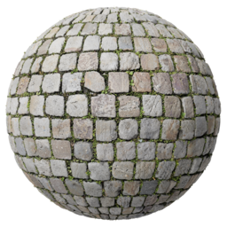</a> <b><a href="PavingStones070">Paving Stones 070</a></b> by ambientCG · <a href="https://ambientcg.com/a/PavingStones070">source</a> | <a href="PavingStones071">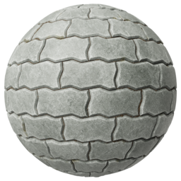</a> <b><a href="PavingStones071">Paving Stones 071</a></b> by ambientCG · <a href="https://ambientcg.com/a/PavingStones071">source</a> | <a href="PavingStones072">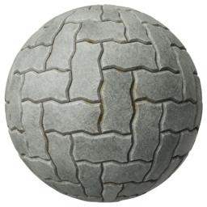</a> <b><a href="PavingStones072">Paving Stones 072</a></b> by ambientCG · <a href="https://ambientcg.com/a/PavingStones072">source</a> | <a href="PavingStones073">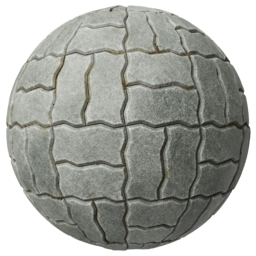</a> <b><a href="PavingStones073">Paving Stones 073</a></b> by ambientCG · <a href="https://ambientcg.com/a/PavingStones073">source</a> |
| <a href="PavingStones074">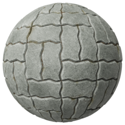</a> <b><a href="PavingStones074">Paving Stones 074</a></b> by ambientCG · <a href="https://ambientcg.com/a/PavingStones074">source</a> | <a href="PavingStones075">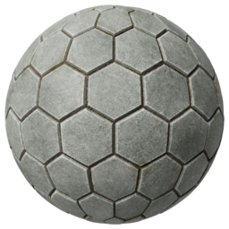</a> <b><a href="PavingStones075">Paving Stones 075</a></b> by ambientCG · <a href="https://ambientcg.com/a/PavingStones075">source</a> | <a href="PavingStones076">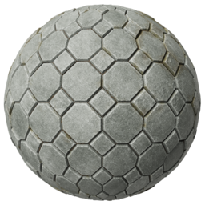</a> <b><a href="PavingStones076">Paving Stones 076</a></b> by ambientCG · <a href="https://ambientcg.com/a/PavingStones076">source</a> | <a href="PavingStones077">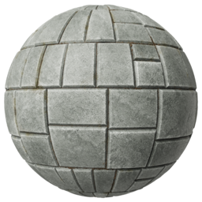</a> <b><a href="PavingStones077">Paving Stones 077</a></b> by ambientCG · <a href="https://ambientcg.com/a/PavingStones077">source</a> |
| <a href="PavingStones078">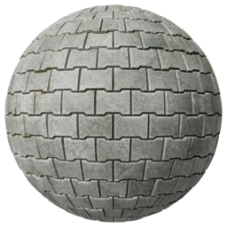</a> <b><a href="PavingStones078">Paving Stones 078</a></b> by ambientCG · <a href="https://ambientcg.com/a/PavingStones078">source</a> | <a href="PavingStones079">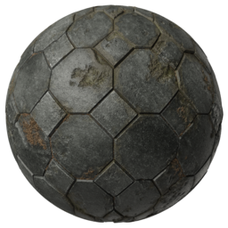</a> <b><a href="PavingStones079">Paving Stones 079</a></b> by ambientCG · <a href="https://ambientcg.com/a/PavingStones079">source</a> | <a href="PavingStones080">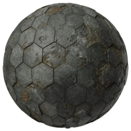</a> <b><a href="PavingStones080">Paving Stones 080</a></b> by ambientCG · <a href="https://ambientcg.com/a/PavingStones080">source</a> | <a href="PavingStones081">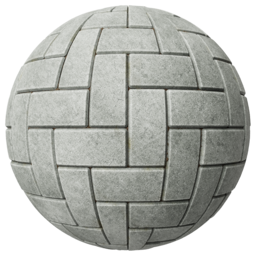</a> <b><a href="PavingStones081">Paving Stones 081</a></b> by ambientCG · <a href="https://ambientcg.com/a/PavingStones081">source</a> |
| <a href="PavingStones082">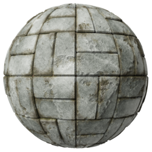</a> <b><a href="PavingStones082">Paving Stones 082</a></b> by ambientCG · <a href="https://ambientcg.com/a/PavingStones082">source</a> | <a href="PavingStones083">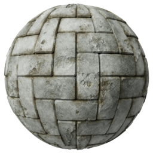</a> <b><a href="PavingStones083">Paving Stones 083</a></b> by ambientCG · <a href="https://ambientcg.com/a/PavingStones083">source</a> | <a href="PavingStones084">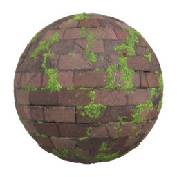</a> <b><a href="PavingStones084">Paving Stones 084</a></b> by ambientCG · <a href="https://ambientcg.com/a/PavingStones084">source</a> | <a href="PavingStones085">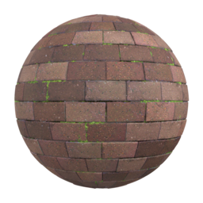</a> <b><a href="PavingStones085">Paving Stones 085</a></b> by ambientCG · <a href="https://ambientcg.com/a/PavingStones085">source</a> |
| <a href="PavingStones086">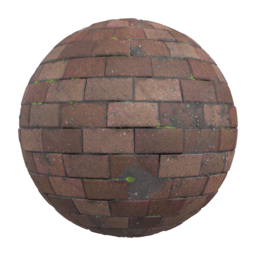</a> <b><a href="PavingStones086">Paving Stones 086</a></b> by ambientCG · <a href="https://ambientcg.com/a/PavingStones086">source</a> | <a href="PavingStones087">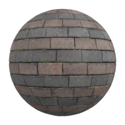</a> <b><a href="PavingStones087">Paving Stones 087</a></b> by ambientCG · <a href="https://ambientcg.com/a/PavingStones087">source</a> | <a href="PavingStones088">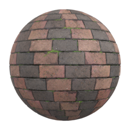</a> <b><a href="PavingStones088">Paving Stones 088</a></b> by ambientCG · <a href="https://ambientcg.com/a/PavingStones088">source</a> | <a href="PavingStones089">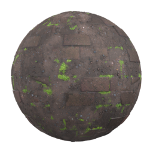</a> <b><a href="PavingStones089">Paving Stones 089</a></b> by ambientCG · <a href="https://ambientcg.com/a/PavingStones089">source</a> |
| <a href="PavingStones090">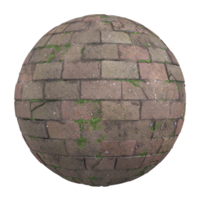</a> <b><a href="PavingStones090">Paving Stones 090</a></b> by ambientCG · <a href="https://ambientcg.com/a/PavingStones090">source</a> | <a href="PavingStones091">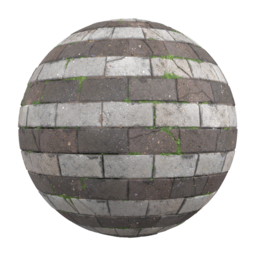</a> <b><a href="PavingStones091">Paving Stones 091</a></b> by ambientCG · <a href="https://ambientcg.com/a/PavingStones091">source</a> | <a href="PavingStones092">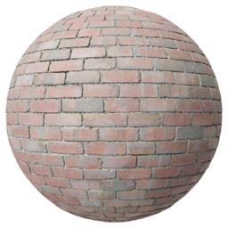</a> <b><a href="PavingStones092">Paving Stones 092</a></b> by ambientCG · <a href="https://ambientcg.com/a/PavingStones092">source</a> | <a href="PavingStones093">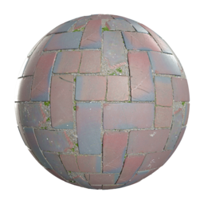</a> <b><a href="PavingStones093">Paving Stones 093</a></b> by ambientCG · <a href="https://ambientcg.com/a/PavingStones093">source</a> |

---

Kept up to date by this repository's own [update workflow](.github/workflows/update.yml), with code and plan from [cc0-mirror](https://github.com/zuujis-cc0/cc0-mirror). Something wrong? [Open an issue there](https://github.com/zuujis-cc0/cc0-mirror/issues/new) or use the [private report form](https://games.zuujis.com/report).
